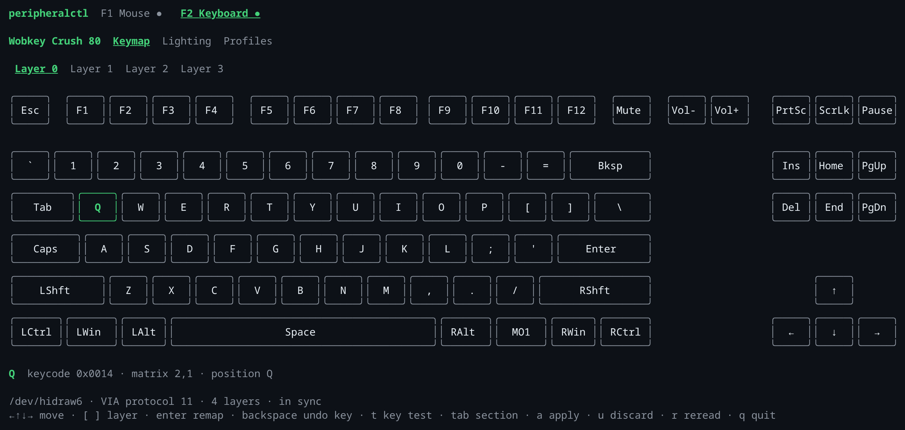
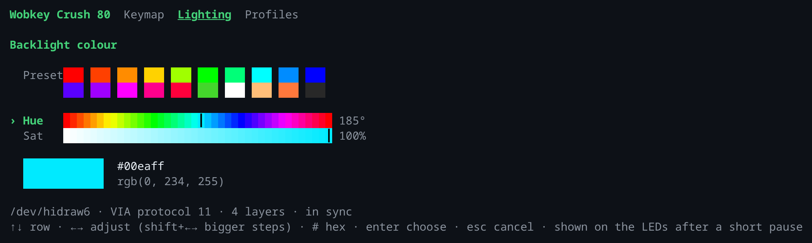
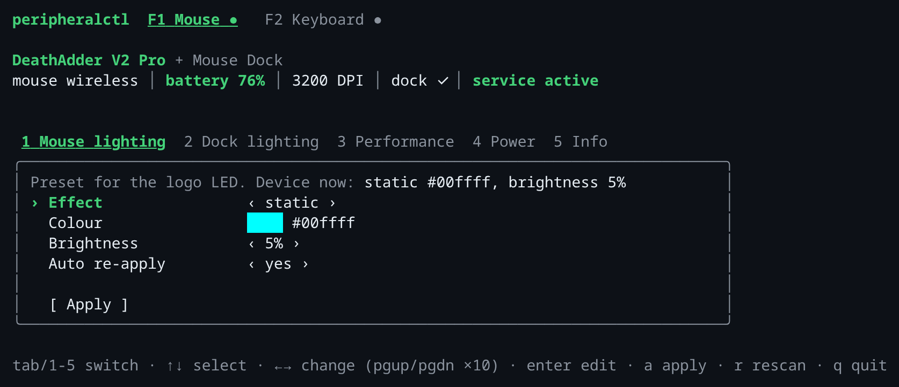

# peripheralctl

[](https://github.com/Giftpilz0/peripheralctl/actions/workflows/ci.yml)
[](LICENSE)

A terminal UI for Razer mice and VIA keyboards on Linux, with a user service that keeps the mouse lighting preset applied.

> [!WARNING]
> This repo was mostly vibecoded and is not safe to use. It writes settings to your mouse and keyboard over raw HID, and it has only been tested on one DeathAdder V2 Pro, Mouse Dock and Wobkey Crush 80. Use it at your own risk.





## Usage

```sh
curl -fsSLO https://github.com/Giftpilz0/peripheralctl/releases/latest/download/peripheralctl_linux_amd64.tar.gz
tar xzf peripheralctl_linux_amd64.tar.gz peripheralctl
./peripheralctl install   # binary to ~/.local/bin, udev rule (sudo), user service; rerun to upgrade
```

```sh
peripheralctl               # terminal UI; F1/F2 switch between mouse and keyboard
peripheralctl import FILE   # add a keyboard from its VIA JSON definition
peripheralctl uninstall     # remove everything; --purge also deletes the settings
```

Service log: `journalctl --user -u peripheralctl -f`

Only the DeathAdder V2 Pro, Mouse Dock and Wobkey Crush 80 are written to. Every other model is shown read-only with a warning, and importing a definition does not change that.

To add a Razer mouse, add a line to `Models` in `internal/razer/models.go`, using OpenRazer's values. To add a VIA keyboard, import its definition and run `peripheralctl install` again. After testing a model, allow writes with `WriteSafe` in `models.go` or `writeSafe` in `internal/via/definition.go`.

## Development

Every push to `main` that passes CI is released as `v0.0.N`. Run `just` for all recipes and `just check` before committing. Conventions: [Giftpilz0/shared](https://github.com/Giftpilz0/shared).

## License

[MIT](LICENSE)
